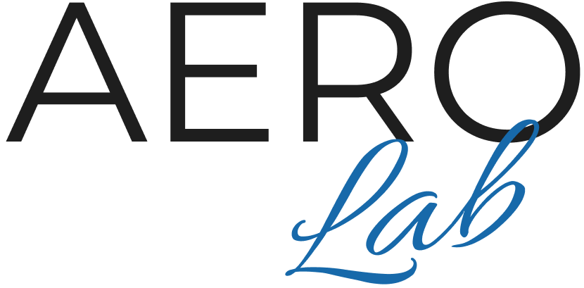

<p align="center">
  
</p>

<h1 align="center">AeroLab — 3D Aircraft CFD &amp; 2D Airfoil Wind Tunnel</h1>

<p align="center">
  Unified aerodynamic simulation workstation combining a <strong>3D Biot-Savart Aircraft CFD Wind Tunnel</strong> and a GPU-accelerated <strong>2D Lattice-Boltzmann (D2Q9) Airfoil Lab</strong> with live 2D-to-3D wing extrusion, Bézier airfoil sculpting, NeuroFoil surrogate polars, and pilot flight logs.
</p>

<p align="center">
  <a href="LICENSE"></a>
  <a href="LICENSES/Apache-2.0.txt"></a>
  <a href="LICENSES/MIT.txt"></a>
</p>

---

## Key Capabilities

### 1. 3D Aircraft CFD Wind Tunnel (`/` — 3D CFD Mode)
- **Built-in Aircraft & Airfoil Geometries (`public/models/` + Procedural)**:
  - **F-22 Raptor** (`f22_raptor.glb`, Meshopt PBR)
  - **Boeing 787 Dreamliner** (`boeing_787.glb`)
  - **Concorde SST** (`concorde_free_with_interior.glb`)
  - **Airfoil Section 3D** (`airfoil.glb`), **NACA 0012**, **Circular Cylinder**, and **2D Custom Foil** (live extruded 3D wing built directly from your active 2D airfoil coordinates)
- **Biot-Savart Vortex Lattice & Surface Distance Field (`src/engine/`)**:
  - `AircraftSurfaceField.ts` extracts triangle meshes into a `64 × 32 × 48` 3D Euclidean Distance Transform (EDT) grid with smooth $C^1$ surface normals ($\nabla d$) for non-penetrating tangential slip.
  - `FluidDynamics3D.ts` solves a 6-panel horseshoe vortex lattice with Lamb-Oseen viscous core regularization, RK2 advection for smoke ribbons & PIV particles, wingtip vortex roll-up, and stall wake separation.
- **Dual 3D Renderers + CAD Inspector**:
  - **Three.js WebGL2 Wind Tunnel** (`WindTunnelCanvasWebGL.tsx`) with PBR, Wireframe, X-Ray, and CFD $C_p$ Pressure Heatmap shaders, velocity quiver grid, Mach shock cones ($\mu = \arcsin(1/M)$), and 3D Lift/Drag vectors.
  - **Automatic Software 3D Canvas Fallback** (`WindTunnelCanvas3D.tsx`) when WebGL2 is unavailable.
  - **3D CAD Inspector Modal** (`ModelViewerModal.tsx`) with turntable inspection, bounding-box metrics, and PNG capture.
- **Flight Telemetry HUD & Interactive Polars (`TelemetryHUD.tsx`, `AeroCharts.tsx`)**:
  - Real-time $C_L$, $C_D$, $L/D$, Mach number, dynamic pressure $q$, ISA atmospheric density $\rho$, boundary-layer state, upper/lower surface lift split, and downwash angle $\epsilon$.
  - Apache ECharts polars ($C_L$ vs. $\alpha$, Drag Polar $C_L$ vs. $C_D$, Chordwise $C_p$) with **JSON**, **CSV**, **2× PNG**, and **SVG** export.

### 2. 2D Lattice-Boltzmann Airfoil Lab (`/` — 2D Airfoil Mode)
- **GPU D2Q9 WebGL2 Wind Tunnel (`src/lib/lbm/`)**:
  - Real-time `640 × 320` lattice-Boltzmann fluid solver with adaptive steps-per-frame, pause/resume, full reset, and PNG flow snapshot export.
  - Four visualization modes: **Velocity**, **Pressure ($C_p$)**, **Vorticity**, and **Smoke**.
- **Airfoil Library & Bézier Shape Editor (`AirfoilPicker.tsx`, `ShapeEditor2D.tsx`)**:
  - Built-in NACA/Selig `.dat` catalog (`public/examples/`), drag-and-drop `.dat`/`.txt` parser (`src/lib/airfoilParser.js`), and interactive cubic Bézier camber & thickness sculpting that syncs live to both the 2D tunnel and the 3D **2D Custom Foil** wing.
- **NeuroFoil Surrogate & Benchmark Comparison (`src/lib/neurofoil.ts`, `ResultsAnalytics.tsx`, `BenchmarkComparison.tsx`)**:
  - Extracts 7 geometric descriptors to predict $-8^\circ \dots +20^\circ$ viscous polars, peak $L/D$, optimal $\alpha^*$ (with 1-click **`Jump α*`**), stall margin, and Plotly polar/time-series comparison against uploaded `.csv`/`.json`/`.dat` reference polars.

### 3. Pilot Profile & Local / Cloud Sync (`/profile`)
- **Profile Customization (`ProfilePage.tsx`, `SupabaseProvider.tsx`)**:
  - Client-side resilient image cropper (`256 × 256` avatar & `1200 × 320` wide cover banner) with multi-stage decoding (`createImageBitmap` + `FileReader` data URL + object URL fallback) and drag-and-drop support.
  - **Local Pilot Mode** saves pilot details, avatars, and cover banners in `localStorage` automatically when Supabase credentials are absent.
  - **Optional Supabase Cloud Sync**: Add `VITE_SUPABASE_URL` and `VITE_SUPABASE_PUBLISHABLE_KEY` to enable Email/Google Auth, community `.dat` airfoil sharing, simulation benchmark publishing, and cloud storage buckets.

---

## Tech Stack

- **Frontend**: React 19, TypeScript, React Router, Tailwind CSS v4, Lucide & Phosphor Icons
- **3D & Physics**: Three.js (`GLTFLoader`, `MeshoptDecoder`, `OrbitControls`, `RoomEnvironment`), WebGL2 GLSL D2Q9 Lattice-Boltzmann Solver, 3D Biot-Savart Vortex Lattice + EDT Surface Field
- **Visualization**: Apache ECharts (`echarts`), `plotly.js-basic-dist-min`

---

## Local Development

1. **Install dependencies**
   ```bash
   npm install
   ```

2. **Configure environment variables (optional)**
   Copy `.env.example` to `.env` if using Supabase cloud sync:
   ```env
   VITE_SUPABASE_URL=""
   VITE_SUPABASE_PUBLISHABLE_KEY=""
   ```

3. **Start the development server** (port `3000`)
   ```bash
   npm run dev
   ```

4. **Type-check and build**
   ```bash
   npm run lint
   npm run build
   ```

5. **Database & Storage Setup for `.glb` Models (Supabase SQL)**
   Run this SQL in your Supabase SQL Editor if `glb_models` or the `models` bucket are not created yet:
   ```sql
   create table if not exists public.glb_models (
     id text primary key,
     name text not null,
     filename text not null,
     file_size_bytes bigint not null default 0,
     model_class text not null default 'other',
     nose_axis text not null default '-X',
     up_axis text not null default '+Y',
     calibration jsonb not null default '{}'::jsonb,
     bounds jsonb not null default '{}'::jsonb,
     uploader_name text not null default 'Community',
     uploader_uid text not null default '',
     visibility text not null default 'public',
     storage_path text not null default '',
     storage_url text not null default '',
     created_at timestamptz not null default now()
   );

   alter table public.glb_models enable row level security;
   create policy "Public read glb_models" on public.glb_models for select using (visibility = 'public');
   create policy "Public insert glb_models" on public.glb_models for insert with check (true);
   create policy "Owner update glb_models" on public.glb_models for update using (uploader_uid = '' or uploader_uid = auth.uid()::text);
   create policy "Owner delete glb_models" on public.glb_models for delete using (uploader_uid = '' or uploader_uid = auth.uid()::text);

   insert into storage.buckets (id, name, public)
   values ('models', 'models', true)
   on conflict (id) do nothing;

   create policy "Public read models bucket" on storage.objects for select using (bucket_id = 'models');
   create policy "Public upload models bucket" on storage.objects for insert with check (bucket_id = 'models');
   create policy "Public update models bucket" on storage.objects for update using (bucket_id = 'models');
   create policy "Public delete models bucket" on storage.objects for delete using (bucket_id = 'models');
   ```

---

## Licenses

- **Primary Project License**: **GNU Affero General Public License v3.0 (AGPL-3.0)** — see [`LICENSE`](LICENSE).
- **Other / Component Licenses**: Incorporates components from **Aeromaterix-CFD** (`Apache-2.0`), the **Kutta** 2D LBM solver (`MIT`), and open-source npm dependencies (`MIT`, `Apache-2.0`, `BSD-2-Clause`, `ISC`, and GSAP Standard License). See [`THIRD_PARTY_LICENSES.md`](THIRD_PARTY_LICENSES.md), [`LICENSES/Apache-2.0.txt`](LICENSES/Apache-2.0.txt), and [`LICENSES/MIT.txt`](LICENSES/MIT.txt) for complete details.
